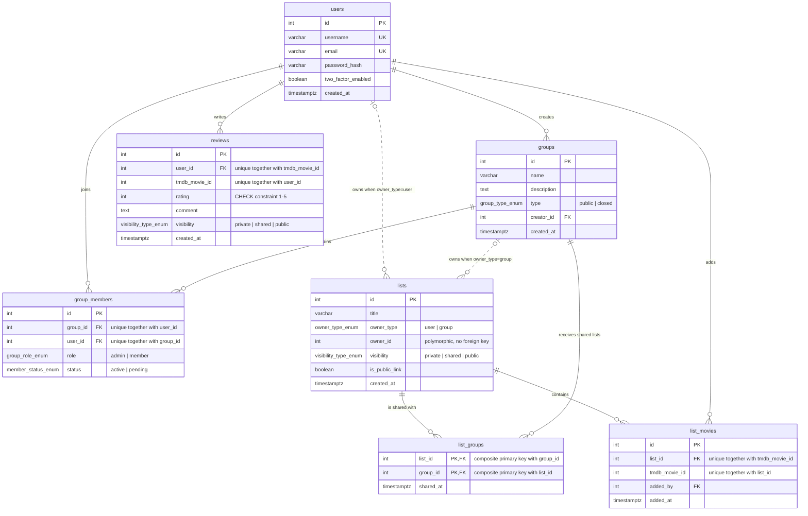
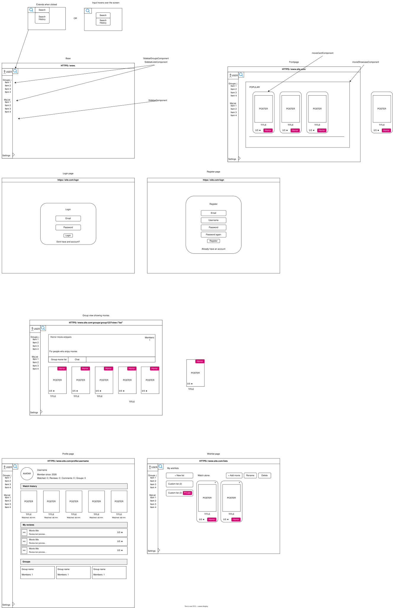

# Tekninen Määrittely - Elokuvasovellus & Yhteisöalusta

## 1. Järjestelmän Arkkitehtuuriratkaisut

Järjestelmä toteutetaan kolmikerroksisena kontitettuna verkkosovelluksena, joka hyödyntää mikro- tai monoliittipalveluarkkitehtuuria (kontitettu monoliitti).

- **Käyttöliittymäkerros (Frontend):** React (SPA), joka toimii käyttäjän selaimessa ja viestii Express-backendin kanssa REST API:n kautta.
- **Sovelluslogiikkakerros (Backend):** Node.js + Express -palvelin, joka käsittelee autentikoinnin, liiketoimintalogiikan (ryhmät, arvostelut, listat) ja ulkoiset rajapintakutsut.
- **Tietovarastokerros (Database):** PostgreSQL-relaatiotietokanta sekä TMDB API:sta haettavan datan on-demand-välimuisti (Read-Through Cache).
- **Kontitus ja Kontinohjaus (DevOps):** Docker ja Docker Compose paikallisessa kehityksessä, GitHub Actions CI/CD -putki sekä julkaisu Azure App Service / Container Instance -ympäristöön.

---

## 2. Teknologiavalinnat

### 2.1 Ohjelmointikielet ja Suoritusympäristöt

- **Frontend:** JavaScript (React)
- **Backend:** Node.js (JavaScript)
- **Tietokanta:** SQL (PostgreSQL)

### 2.2 Frameworkit ja Keskeiset Kirjastot

- **Frontend-kirjastot:**
  - React.js (Käyttöliittymä)
  - React Router (Sivunsisäinen reititys)
  - Axios / Fetch API (API-pyynnöt)
  - Tailwind CSS (Tyylittely ja responsiivisuus)
- **Backend-kirjastot:**
  - Express.js (HTTP-palvelin ja REST-reitit)
  - `pg` / `node-postgres` (Tietokantayhteydet)
  - `bcrypt` (Salasanojen hajautus)
  - `jsonwebtoken` (JWT-pohjainen sessiohallinta)
  - `dotenv` (Ympäristömuuttujat)

### 2.3 Ympäristöt ja Infrastruktuuri

- **Kehitysympäristö:** Docker & Docker Compose
- **CI/CD:** GitHub Actions
- **Pilvialusta:** Azure App Service / Azure Database for PostgreSQL

---

## 3. Tietokantasuunnittelu

Tietokantana toimii PostgreSQL. Järjestelmässä hyödynnetään `movies`-taulua välimuistina TMDB API:sta haettaville elokuville suorituskyvyn optimoimiseksi.

### Tietokantakaavio




### Listan näkyvyyden CHECK-rajoite

Seuraava rajoite määrittää listan omistajatyypin ja näkyvyyden sallitut yhdistelmät:

```sql
CONSTRAINT chk_list_owner_visibility
CHECK (
  (
    owner_type = 'user'
    AND visibility IN ('private', 'shared', 'public')
  )
  OR
  (
    owner_type = 'group'
    AND visibility IN ('private', 'public')
  )
)
```

Rajoite sallii käyttäjän omistamalle listalle seuraavat näkyvyysarvot:

- `private`: lista näkyy vain omistajalle
- `shared`: lista näkyy omistajalle ja valittujen ryhmien jäsenille
- `public`: lista on julkinen

Rajoite sallii ryhmän omistamalle listalle seuraavat näkyvyysarvot:

- `private`: lista näkyy vain ryhmän jäsenille
- `public`: lista on julkinen

Rajoite estää ryhmän omistamaa listaa käyttämästä `shared`-näkyvyysarvoa.

`list_groups`-taulua käytetään vain silloin, kun käyttäjän omistama lista jaetaan yhdelle tai useammalle ryhmälle. Ryhmän omistaman listan ryhmä määritetään edelleen `lists.owner_id`-kentässä.


---

## 4. Käyttöliittymäsuunnittelu Teknisellä Tasolla

Käyttöliittymä toteutetaan yksisivuisena sovelluksena (Single Page Application, SPA) Reactilla.

- **Tilanhallinta (State Management):**
  - Globaali tila: Käyttäjän kirjautumistieto (JWT Token, User Profile) toteutetaan React Context API:lla.
  - Paikallinen tila: Hakukentät, lomaketiedot ja näkymäkohtaiset valinnat `useState`- ja `useReducer`-koukuilla.
- **Reititys (React Router):**
  - `/` - Etusivu (Hakupalkki, trendaavat elokuvat, uusimmat arvostelut)
  - `/movie/:id` - Elokuvan yksityiskohtasivu
  - `/groups` - Ryhmien selaus ja luonti
  - `/groups/:id` - Ryhmäsivu (jäsenet, ryhmän yhteiset listat)
  - `/profile` - Käyttäjän omat tiedot, omat listat ja arvostelut
  - `/login` & `/register` - Autentikointisivut
- **Kuvanlataus ja CDN-integraatio:**
  - Postereita ei ladata omalle palvelimelle, vaan selaimelle muodostetaan kuvaosoitteet TMDB:n CDN-pohjaosoitteen ja kantaan

### Käyttöliittymäsuunnitelma

---

## 5. Rajapinnat (API:t) ja Integraatiot

### 5.1 Sisäinen REST API (Express)

- **Autentikointi:**
  - `POST /api/auth/register` - Rekisteröinti
  - `POST /api/auth/login` - Kirjautuminen (palauttaa JWT-tokenin)
- **Elokuvat & Haku:**
  - `GET /api/movies/search?q=query` - Elokuvahaku (tarkistaa kannan, tarvittaessa tekee TMDB-kutsun ja tallentaa kantaan)
  - `GET /api/movies/:id` - Elokuvan yksityiskohdat
- **Ryhmät:**
  - `GET /api/groups` - Hae ryhmät
  - `POST /api/groups` - Luokse uusi ryhmä
  - `POST /api/groups/:id/join` - Hae ryhmän jäsenyyttä
- **Listat & Arvostelut:**
  - `POST /api/lists` - Luokse lista (kayttaja tai ryhma)
  - `POST /api/reviews` - Tallenna arvostelu (`private`, `group`, `public`)

### 5.2 Ulkoiset Integraatiot

- **TMDB API (The Movie Database):**
  - Haetaan elokuvien perustiedot, hakutulokset ja teatteritiedot.
  - Backend tekee kutsut hyödyntäen `TMDB_API_KEY`-ympäristömuuttujaa.

---

## 6. Moduulit, Komponentit ja Riippuvuudet

```
[ React UI Komponentit ]
       │
       ▼ (HTTP / REST API)
[ Express Controller -kerros ]
       │
       ├────────────────────────┐
       ▼                        ▼
[ Service -kerros ]     [ TMDB API Client ]
       │                        │
       ▼                        │ (Ainoastaan kun kanta ei sisällä dataa)
[ Database Data Mapper ]        │
       │                        │
       ▼                        │
[ PostgreSQL Tietokanta ] ◄─────┘
```

1. **Auth Module:** Vastaa käyttäjien tunnistamisesta, salasanojen cryptauksesta ja JWT-tokenien luonnista.
2. **Movie Engine & Cache Module:** Hoitaa haut PostgreSQL-tietokannasta sekä varayhteyden TMDB API:in.
3. **Group & Social Module:** Hallinnoi ryhmäyhteyksiä, rooleja (`admin`/`member`) ja näkyvyysasetuksia.
4. **Review & List Module:** Käsittelee elokuvien lisäämisen listoille ja suorittaa näkyvyystarkistukset arvosteluille.

---

## 7. Tietoturvaratkaisut

- **Salasanojen Suojaus:** Salasanat hajautetaan (hash) käyttäen `bcrypt`-kirjastoa riittävällä suolaustasolla ennen tietokantaan tallennusta.
- **Sessiohallinta:** JWT (JSON Web Token) tallennetaan turvallisesti käyttäjän selaimeen (HTTPOnly Cookie tai Secure LocalStorage).
- **Syötteiden Validointi ja SQL-injektio:** Kaikki tietokantakyselyt toteutetaan parametrisoiduilla SQL-kyselyillä (`pg`-kirjaston `$1`, `$2`-syntaksi) SQL-injektiohyökkäysten estämiseksi.
- **CORS & Helmets:** Express-palvelimessa käytetään `cors`- ja `helmet`-väliohjelmistoja otsikoiden (headers) ja verkkoliikenteen turvaamiseksi.
- **Ympäristömuuttujat:** Salaisuudet (API-avaimet, tietokantasalasanat, JWT Secret) pidetään poissa koodirepositoriosta ja hallitaan `.env`-tiedostojen sekä Azuren / GitHub Actionsin salaisuuksien (Secrets) kautta.

---

## 8. Suorituskykyvaatimukset ja -ratkaisut

- **Kyselyiden Optimointi & Caching:**
  - Read-Through Cache -malli suoraan tietokannassa pienentää ulkoisten verkkoviiveiden määrää ja estää TMDB API-kutsurajojen ylittymisen.
  - Suosituimmat hakuindeksit (kuten `tmdb_id`, `user_id`, `group_id`) mahdollistavat nopeat haut myös tietokannan kasvaessa.
- **Kuvien Suorituskyky (CDN):**
  - Postereiden ja median lataaminen ulkoistetaan täysin TMDB:n maailmanlaajuiselle CDN-verkolle, mikä pitää oman palvelimen kaistanleveyden minimaalisena.
- **Konttien Skaalautuvuus:**
  - Backend ja tietokanta on erotettu omiksi konteikseen, mikä mahdollistaa backend-palvelimen nopean horisontaalisen skaalauksen pilviympäristössä (Azure App Service).
